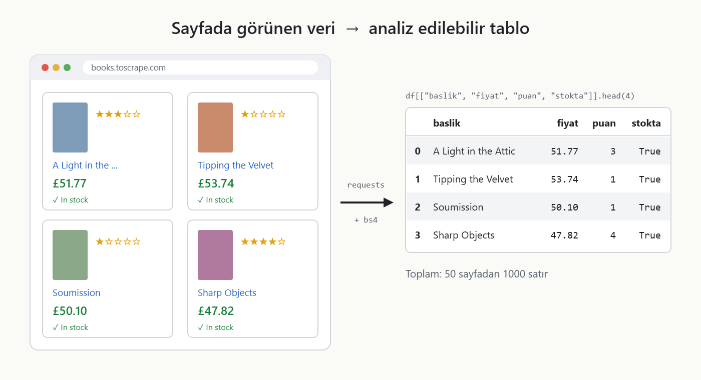
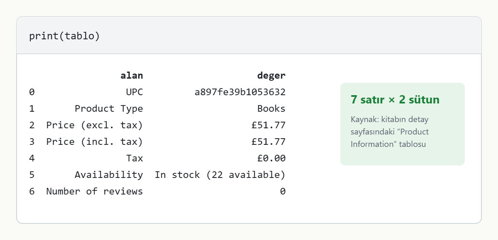
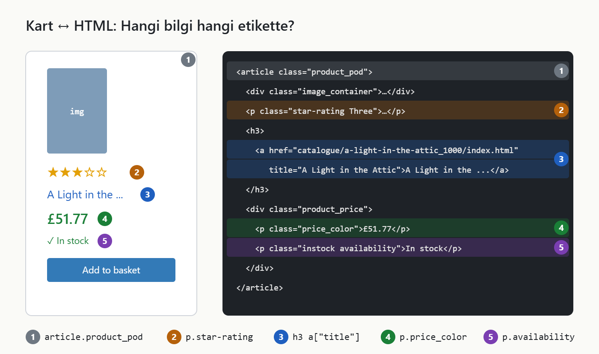
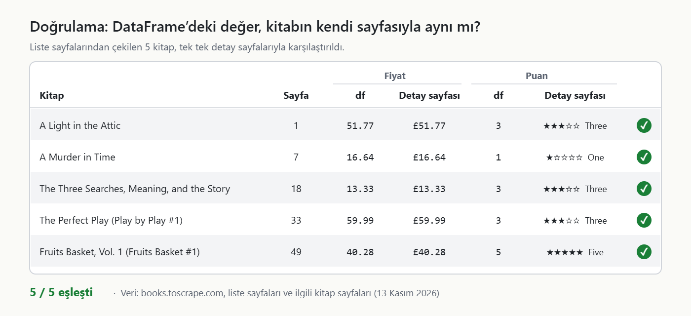
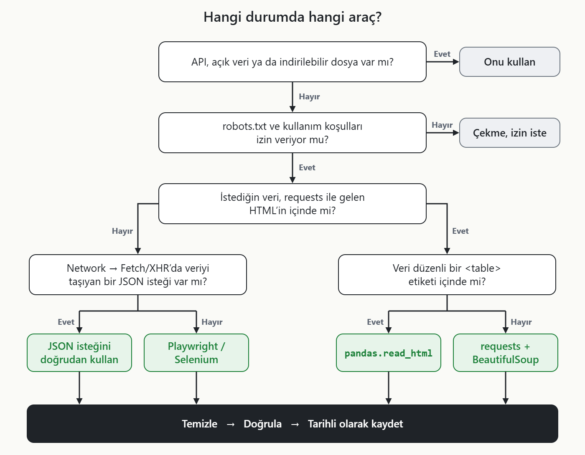

# HTML Scraping: API Sunmayan Sayfalardan Python ile Güvenilir Veri Çekmek



Bu repo, **"API Yoksa Veri de Yok mu? Python ile HTML Sayfalarından Güvenilir Veri Çekmek"** başlıklı Medium yazısının kodunu içerir.

📝 Medium yazısı: _[link yayımlandıktan sonra eklenecek]_

Örnek veri kaynağı olarak, web scraping alıştırması için hazırlanmış kurgusal mağaza [books.toscrape.com](https://books.toscrape.com/) kullanılmıştır.

## İçerik

| Dosya | Açıklama |
|---|---|
| [`scraper.py`](scraper.py) | Yazıdaki tüm adımların çalıştırılabilir hali |
| [`requirements.txt`](requirements.txt) | Gerekli kütüphaneler |
| [`images/`](images) | Yazıdaki görseller |

## Kurulum ve çalıştırma

```bash
pip install -r requirements.txt
python scraper.py
```

Script 50 liste sayfasını, her istek arasında 1 saniye bekleyerek dolaşır. Bu yüzden yaklaşık 1 dakika sürer. Sonuç, `kitaplar_YYYY-AA-GG.csv` adıyla kaydedilir.

## Adımlar

### 0. İzin kontrolü
`urllib.robotparser` ile robots.txt okunur. Gerçek projelerde sitenin kullanım koşulları da ayrıca okunmalıdır.

### 1. Hızlı yol: `pandas.read_html`
Veri bir `<table>` içindeyse tek satırda DataFrame'e çevrilir.



### 2. Kontrollü yol: `requests` + `BeautifulSoup`
Kitap listesi bir tablo değil, kartlardan oluşuyor. Her bilgi bir CSS seçicisiyle alınır.



### 3. Sayfalama ve istek hızı
`li.next a` linki takip edilir. İstekler arasına `time.sleep(1)` konur.

### 4. Temizleme ve doğrulama
Fiyat `float`, puan `int` tipine çevrilir. Ardından satır sayısı, benzersizlik, eksik değer ve değer aralığı `assert` ile kontrol edilir. Son olarak birkaç satır kaynak sayfayla elle karşılaştırılır.



### Hangi durumda hangi araç?



## Dikkat edilmesi gerekenler

- **Encoding:** Sunucu `Content-Type` başlığında karakter seti bildirmediğinde `requests` ISO-8859-1 varsayar ve `£` işareti `£` olarak görünür. Bu yüzden kodda `r.encoding = "utf-8"` satırı var.
- **Türetilmiş sütunlar:** `puan` ve `stokta` sütunları kaynakta metin olarak bulunan değerlerin dönüştürülmüş halidir. Kaynakta olmayan hiçbir değer eklenmemiştir.
- **Kırılganlık:** Sitenin HTML yapısı değişirse seçiciler boş sonuç döner. `dogrula()` fonksiyonu bu durumu erken yakalamak içindir.

## Etik ve yasal not

- robots.txt'ye ve kullanım koşullarına uyun.
- İstekler arasına bekleme koyun; HTTP 429 alırsanız yavaşlayın.
- `User-Agent` alanında kendinizi tanıtın.
- Kişisel veri çekmeyin (KVKK).
- Veriyi paylaşırken kaynağını belirtin.

## Kaynaklar

- [requests](https://requests.readthedocs.io/en/latest/)
- [Beautiful Soup](https://www.crummy.com/software/BeautifulSoup/bs4/doc/)
- [pandas.read_html](https://pandas.pydata.org/docs/reference/api/pandas.read_html.html)
- [Playwright for Python](https://playwright.dev/python/)
- [RFC 9309: Robots Exclusion Protocol](https://www.rfc-editor.org/rfc/rfc9309)
